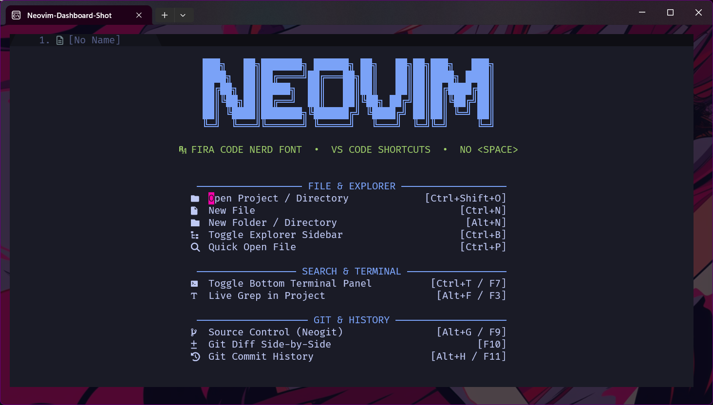
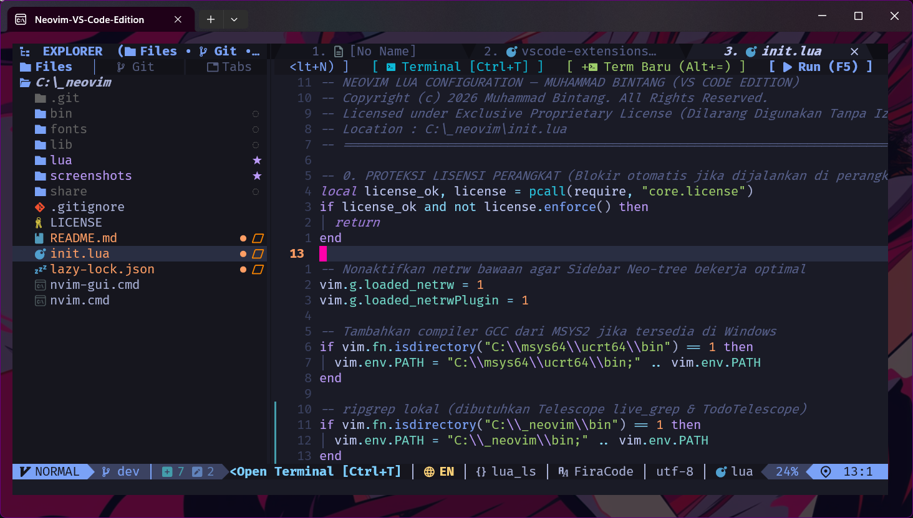
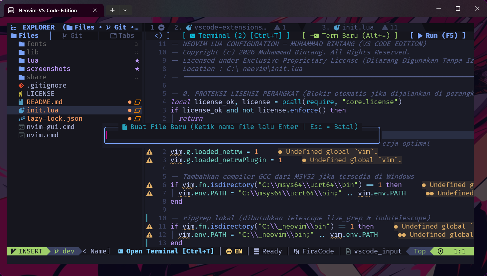
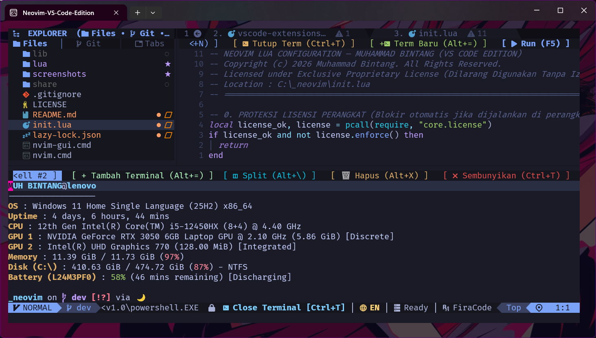

# ⚡ Neovim VS Code Edition — FiraCode Nerd Font & Modular Lua IDE (`C:\_neovim`)

[🇮🇩 Bahasa Indonesia](#-bahasa-indonesia) | [🇬🇧 English](#-english)

---

<a id="-bahasa-indonesia"></a>
# 🇮🇩 Bahasa Indonesia

Dokumentasi resmi konfigurasi **Neovim v0.11.5 (100% Modular Lua)** yang dirancang khusus untuk menghadirkan pengalaman, tampilan modern, **Multi-Terminal**, dan **shortcut keyboard 100% standar Visual Studio Code** — **tanpa perlu kombinasi tombol `<Space>`**.

---

## 📸 Tangkapan Layar (*Screenshots Gallery*)

Berikut adalah tampilan antarmuka Neovim VS Code Edition dalam aksi:

### 1. Dashboard Awal (*Grouped Menu & Bilingual ID / EN*)
> *Halaman sambutan terkelompok rapi per kategori dengan pilihan Bahasa Indonesia / English (`Alt + L`) dan Project Picker (`Ctrl + Shift + O`).*



### 2. Tampilan Utama Editor, Sidebar & Winbar Tab (VS Code Style)
> *Menampilkan sidebar Neo-tree di kiri, baris tab Bufferline di atas, editor kode dengan FiraCode Nerd Font, Winbar navigasi interaktif, dan status bar bawah.*



### 3. Fitur Kotak Input Mengambang (*Floating Input Modal*) untuk Buat File & Folder
> *Kotak input mengambang di tengah layar saat Anda menekan `Ctrl + N` (Buat File) atau `Alt + N` (Buat Folder).*



### 4. Multi-Terminal Manager & Split Terminal di Panel Bawah
> *Panel terminal bawah yang mendukung banyak tab PowerShell (`PowerShell #1`, `#2`, `#3`), Split Terminal, dan tombol kontrol interaktif.*



---

## 🌟 Fitur Utama

1. **󰛖 Font FiraCode Nerd Font & Ikon Lengkap**:
   - Menggunakan **FiraCode Nerd Font** dengan *ligatures* yang aktif otomatis di Windows Terminal, VS Code Terminal, dan Neovim.
   - Dilengkapi 3 paket ikon (`nvim-web-devicons`, `mini.icons`, `lspkind.nvim`) untuk mewarnai jenis file, folder, dan autocomplete.
2. **📄 Buat File & Folder dengan Floating Modal**:
   - Kotak input elegan di tengah layar (`Ctrl + N` untuk File, `Alt + N` untuk Folder). Mendukung pembuatan direktori otomatis jika diakhiri `/`.
3. ** Multi-Terminal Manager**:
   - Tambah banyak tab terminal (`Alt +=`), Split Terminal berdampingan (`Alt + \`), dan pindah antar terminal (`Alt + ]` / `Alt + [`).
4. **⌨️ 100% Shortcut Standar VS Code**:
   - Seluruh navigasi dan editing menggunakan `Ctrl`, `Alt`, dan `F1–F12` tanpa tombol `<Space>`.
5. **🌐 Menu Pilih Bahasa (Dashboard)**:
   - Dashboard tersusun rapi per kategori (File, Cari/Terminal, Git, Preferensi) dengan shortcut yang sejajar.
   - Pilih **Bahasa Indonesia** atau **English** lewat tombol `󰖟` di Dashboard, `Alt + L`, atau perintah `:Lang` (`:LangID` / `:LangEN`).
   - Pilihan tersimpan otomatis dan langsung memperbarui teks menu Dashboard serta badge bahasa di status bar.
6. **󰉋 Buka Project / Directory**:
   - Tekan tombol `󰉋` di Dashboard, `Ctrl + Shift + O`, atau perintah `:OpenProject` untuk mencari folder project.
   - Pencarian memakai Telescope (project terakhir muncul lebih dulu), lalu `Enter` untuk masuk.
   - Neovim otomatis pindah `cwd` ke folder itu, Dashboard ditutup, dan Sidebar Neo-tree langsung menampilkan isi project tersebut.
   - Root awal paling luar: **semua drive** (`C:\`, `D:\`, ...) + `~` + cwd, jadi folder seperti `C:\laragon\www` atau file perkuliahan ikut kesearch.
   - Atur sendiri: `vim.g.nvim_project_roots = { "D:/project", "C:/work" }` dan kedalaman `vim.g.nvim_project_depth = 3` (default).
7. **🧩 Ekstensi VS Code → Plugin Neovim**:
   - **Auto Rename Tag / Auto Close Tag** (`nvim-ts-autotag`) — ganti nama tag HTML/PHP/JSX/Vue/Svelte otomatis di pembuka & penutup.
   - **Color Highlight** (`nvim-colorizer`) — warna hex/rgb/hsl/nama warna & kelas Tailwind tampil langsung di editor.
   - **Better Comments** (`todo-comments`) — soroti `TODO`, `FIXME`, `WARN`, `HACK`, `NOTE`; daftarkan lewat `Alt + C`.
   - **Error Lens** (`trouble`) — panel error LSP `Alt + M` (semua: `Alt + Shift + M`) + pesan inline di baris kursor.
   - **WakaTime** & **Discord Rich Presence** — memakai `~/.wakatime.cfg` yang sudah ada.
   - **Server LSP otomatis** (Intelephense, Tailwind, TS, HTML/CSS/JSON, ESLint, Vue, Svelte, Prisma, Go, Python, C/C++, Java, Kotlin, Bash, YAML, Docker, CMake) — pasang otomatis lewat Mason; cek dengan `:Mason`.
8. **🔲 Select Code Presisi & 📦 Drag-and-Drop / Copy-Cut-Paste File Explorer**:
   - **Seleksi kode ala VS Code**: `Shift + Panah`, `Ctrl + Shift + Left/Right`, `Shift + Home/End`, `Ctrl + L` (select baris), `Alt + D` (select kata), serta **Treesitter Smart Selection** (`Alt + A` perluas / `Alt + Z` perkecil blok kode).
   - **Kelola & Import File langsung di Sidebar Explorer**: dukung **🖱️ Mouse Drag & Drop** antar folder di Sidebar **maupun drag file/folder dari Windows File Explorer langsung ke folder Sidebar** *(persis VS Code)*, serta **`y` / `Alt + C` / `Ctrl + C`** (Copy), **`x` / `Alt + X` / `Ctrl + X`** (Cut), dan **`p` / `Alt + V` / `Ctrl + V`** (Paste — otomatis mendukung paste file hasil `Ctrl + C` dari Windows Explorer!).

---

## 🚀 Cara Membuka Neovim di Project

Buka terminal di dalam folder project Anda, lalu ketik:
```powershell
nvim .
```
*(atau panggil langsung dari `C:\_neovim`)*:
```powershell
C:\_neovim\nvim.cmd .
```
> **Catatan**: Jika Neovim sudah terbuka, tutup dulu (`Ctrl + Q` atau `:qa!`) lalu buka kembali dengan `nvim .` agar modul terbaru termuat sempurna.

---

## ⌨️ Dokumentasi Shortcut Keyboard (Standar VS Code)

### 1. 📄 Buat File & 📁 Folder Baru
| Shortcut / Tombol | Fungsi |
| :--- | :--- |
| **`Ctrl + N`** *(atau klik `[+󰈔 Buat File]`)* | **Buat File Baru** — Memunculkan kotak input mengambang di tengah layar. Ketik nama file, tekan **`Enter`**. |
| **`Alt + N`** / **`Ctrl + Shift + N`** *(atau klik `[+ Buat Folder]`)* | **Buat Directory / Folder Baru** — Memunculkan kotak input mengambang, ketik nama folder, tekan **`Enter`**. |
| **`F2`** | **Rename File / Folder** yang sedang dibuka atau disorot di Sidebar. |
| **`Alt + Delete`** | **Hapus File Aktif** dengan konfirmasi aman `y`. |
| **`Ctrl + Shift + O`** *(atau klik `[󰉋 Buka Project]`)* | **Buka Project / Directory** — Cari folder project via Telescope, `Enter` untuk pindah ke folder itu. |
| **`Alt + L`** | **Pilih Bahasa** — Buka menu Bahasa Indonesia / English. |

> **Catatan:** Shortcut navigasi (`Alt + Left/Right`, `Alt + 1`–`Alt + 9`, `Alt + X`, `Ctrl + B`, `Alt + E`, `Alt + S`, `Ctrl + Shift + O`) juga aktif **saat sedang mengetik** (insert mode). Klik file di Sidebar otomatis memaksa normal mode, dan klik kembali ke Terminal otomatis masuk mode ketik. (`Tab` tetap dipakai autocomplete saat mengetik.) `ripgrep` untuk pencarian sudah disertakan di `C:\_neovim\bin\rg.exe` dan otomatis masuk PATH Neovim.

### 1b. 📑 Navigasi Tab Halaman File (*Bufferline*)
| Shortcut | Fungsi |
| :--- | :--- |
| **`Alt + Right`** / **`Alt + Left`** | **Pindah ke Tab File Berikutnya / Sebelumnya** *(aktif di Normal & Insert mode)* |
| **`Ctrl + PageDown`** / **`Ctrl + PageUp`** | **Tab File Berikutnya / Sebelumnya** *(standar VS Code)* |
| **`Ctrl + Tab`** / **`Ctrl + Shift + Tab`** | **Tab File Berikutnya / Sebelumnya** *(di terminal yang mendukung)* |
| **`Tab`** / **`Shift + Tab`** | **Tab File Berikutnya / Sebelumnya** *(Normal mode)* |
| **`Alt + 1`** – **`Alt + 9`** | **Lompat Langsung ke Tab #1 s/d #9** |
| **`Alt + P`** | **Pin / Unpin Tab Aktif** |
| **`Alt + X`** / **`Alt + W`** / **`F4`** | **Tutup Tab Code Aktif** tanpa menutup Sidebar *(di dalam terminal, `Alt + X` menutup terminal aktif)* |

### 1c. 📦 Kelola File & Folder di Sidebar Explorer (*Drag, Copy, Cut & Paste*)
| Aksi / Shortcut *(di Sidebar)* | Fungsi |
| :--- | :--- |
| **🖱️ Drag & Drop Mouse *(Internal)*** | **Tarik & Lepas File/Folder** di Sidebar ke folder tujuan untuk memindahkan file langsung *(tersedia notifikasi live saat menyeret)* |
| **📥 Drag dari Windows Explorer** | **Tarik 1 atau Banyak File/Gambar/Folder sekaligus dari Windows File Explorer** dan lepas ke folder yang sedang disorot di Sidebar → semuanya otomatis tersalin masuk *(aman dari overwrite: otomatis beri `(1)` jika nama sama)* |
| **`y`** / **`Alt + C`** / **`Ctrl + C`** | **Copy File/Folder** ke clipboard Explorer *(siap diduplikat; gunakan `y` atau `Alt + C` jika `Ctrl + C` dipakai Windows Terminal)* |
| **`x`** / **`Alt + X`** / **`Ctrl + X`** | **Cut File/Folder** ke clipboard Explorer *(siap dipindahkan)* |
| **`p`** / **`Alt + V`** / **`Ctrl + V`** | **Paste ke Folder Tujuan** — otomatis **duplikat** jika dari Copy, **pindah** jika dari Cut, **atau langsung paste file/folder hasil `Ctrl + C` dari Windows File Explorer!** |
| **`c`** / **`m`** | **Copy / Move Cepat** dengan input path tujuan |
| **`Y`** | **Salin Path Lengkap** file/folder ke Clipboard Windows |
| **`Esc`** | **Batalkan** antrean Copy / Cut di Sidebar |

### 2.  Multi-Terminal PowerShell
| Shortcut / Tombol | Fungsi |
| :--- | :--- |
| **`Ctrl + T`** / **`Ctrl + \`** / **`F7`** | **Buka / Sembunyikan Panel Terminal Bawah** |
| **`Alt + =`** / **`Ctrl + Shift + T`** | **➕ Tambah Terminal Baru** (`PowerShell #2`, `#3`, dst.) |
| **`Alt + ]`** / **`Alt + [`** | **Pindah ke Tab Terminal Berikutnya / Sebelumnya** |
| **`Alt + \`** | **Split Terminal Kanan-Kiri** di panel bawah |
| **`Alt + X`** | **Hapus / Matikan Terminal Aktif** |
| **`Alt + T`** | **Buka / Tutup Floating Terminal** |

### 3. ✏️ Editing, Select Code & Undo/Redo (Standar VS Code)
| Shortcut | Fungsi |
| :--- | :--- |
| **`Shift + Panah`** (`←` `→` `↑` `↓`) | **Select Karakter / Baris** ke kiri, kanan, atas, bawah *(aktif di Normal, Insert & Visual mode)* |
| **`Ctrl + Shift + Left/Right`** | **Select Per Kata** ke kiri / kanan |
| **`Shift + Home`** / **`Shift + End`** | **Select sampai Awal / Akhir Baris** |
| **`Ctrl + L`** | **Select 1 Baris Penuh** *(tekan lagi untuk memperluas ke baris bawah)* |
| **`Alt + D`** | **Select 1 Kata Aktif** di bawah kursor |
| **`Alt + A`** / **`Alt + Z`** | **Smart Expand / Shrink Selection** *(Treesitter: kata → ekspresi → blok → fungsi)* |
| **`Ctrl + A`** | **Select All / Blok Semua** |
| **`Ctrl + Z`** / **`Ctrl + Y`** | **Undo** / **Redo** |
| **`Ctrl + D`** / **`Shift + Alt + Down/Up`** | **Duplikat Baris / Teks** ke bawah atau ke atas |
| **`Alt + Down/Up`** | **Geser Baris (Move Line)** ke bawah / ke atas |
| **`Ctrl + C`** / **`Ctrl + X`** / **`Ctrl + V`** | **Copy** / **Cut** / **Paste** |
| **`Ctrl + /`** | **Toggle Comment** (Beri / hapus komentar baris atau blok) |
| **`Ctrl + S`** | **Simpan File (Save)** |
| **`F5`** | **Run Code** (Jalankan file aktif `.html`, `.js`, `.py`, `.lua`, dll.) |
| **`F6`** | **Ganti Tema Warna** (*TokyoNight* ⇄ *VS Code Dark+* ⇄ *Catppuccin*) |

---

<a id="-english"></a>
---

# 🇬🇧 English

Official documentation for the **Neovim v0.11.5 (100% Modular Lua)** configuration, designed to provide a modern interface, **Multi-Terminal management**, and **100% standard Visual Studio Code keyboard shortcuts** — **without requiring any `<Space>` key combinations**.

---

## 📸 Screenshots Gallery

Here is a preview of the Neovim VS Code Edition interface in action:

### 1. Welcome Dashboard (*Grouped Menu & Bilingual ID / EN*)
> *Categorized welcome screen with Indonesian / English language selector (`Alt + L`) and Project Picker (`Ctrl + Shift + O`).*


### 2. Main Editor, Sidebar & Winbar Tab (VS Code Style)
> *Showing the Neo-tree sidebar on the left, Bufferline file tabs on top, code editor with FiraCode Nerd Font, interactive Winbar, and bottom statusline.*


### 3. Floating Input Modal for Creating Files & Folders
> *The floating input box centered on the screen when pressing `Ctrl + N` (New File) or `Alt + N` (New Folder).*


### 4. Multi-Terminal Manager & Split Terminal
> *The bottom terminal panel supporting multiple PowerShell tabs (`PowerShell #1`, `#2`, `#3`), Split Terminals, and interactive control buttons.*


---

## 🌟 Key Features

1. **󰛖 FiraCode Nerd Font & Rich Icons**:
   - Powered by **FiraCode Nerd Font** with ligatures enabled across Windows Terminal, VS Code Terminal, and Neovim.
   - Includes 3 icon packages (`nvim-web-devicons`, `mini.icons`, `lspkind.nvim`) for file types, folders, and autocomplete.
2. **📄 Create Files & Folders via Floating Modal**:
   - Elegant centered input dialog (`Ctrl + N` for files, `Alt + N` for directories). Automatically creates parent folders when suffixed with `/`.
3. ** Multi-Terminal Manager**:
   - Add multiple terminal tabs (`Alt +=`), split terminals side-by-side (`Alt + \`), and switch tabs (`Alt + ]` / `Alt + [`).
4. **⌨️ 100% VS Code Standard Shortcuts**:
   - All editing and navigation rely on `Ctrl`, `Alt`, and `F1–F12` without needing `<Space>` prefixes.
5. **🌐 Language Menu (Dashboard)**:
   - The dashboard is grouped by category (File, Search/Terminal, Git, Preferences) with aligned shortcuts.
   - Choose **Bahasa Indonesia** or **English** from the `󰖟` dashboard button, `Alt + L`, or the `:Lang` command (`:LangID` / `:LangEN`).
   - Your choice is saved automatically and instantly updates the dashboard text and the language badge in the status bar.
6. **󰉋 Open Project / Directory**:
   - Press the `󰉋` dashboard button, `Ctrl + Shift + O`, or `:OpenProject` to search for a project folder.
   - Searching uses Telescope (recent projects appear first); press `Enter` to enter the folder.
   - Neovim changes `cwd` to that folder, closes the dashboard, and the Neo-tree sidebar immediately shows the project contents.
   - Widest default roots: **all drives** (`C:\`, `D:\`, ...) + `~` + cwd, so folders like `C:\laragon\www` or your college files are searchable.
   - Customize with `vim.g.nvim_project_roots = { "D:/project", "C:/work" }` and depth `vim.g.nvim_project_depth = 3` (default).
7. **🧩 VS Code Extensions → Neovim Plugins**:
   - **Auto Rename Tag / Auto Close Tag** (`nvim-ts-autotag`) — rename HTML/PHP/JSX/Vue/Svelte tags in both opening & closing pairs.
   - **Color Highlight** (`nvim-colorizer`) — hex/rgb/hsl/named colors and Tailwind classes preview inline.
   - **Better Comments** (`todo-comments`) — highlight `TODO`, `FIXME`, `WARN`, `HACK`, `NOTE`; list them with `Alt + C`.
   - **Error Lens** (`trouble`) — LSP error panel `Alt + M` (all: `Alt + Shift + M`) plus inline diagnostics.
   - **WakaTime** & **Discord Rich Presence** — using your existing `~/.wakatime.cfg`.
   - **Automatic LSP servers** (Intelephense, Tailwind, TS, HTML/CSS/JSON, ESLint, Vue, Svelte, Prisma, Go, Python, C/C++, Java, Kotlin, Bash, YAML, Docker, CMake) — installed via Mason; check with `:Mason`.
8. **🔲 Precise Code Selection & 📦 Drag-and-Drop / Copy-Cut-Paste File Explorer**:
   - **VS Code-style code selection**: `Shift + Arrows`, `Ctrl + Shift + Left/Right`, `Shift + Home/End`, `Ctrl + L` (select line), `Alt + D` (select word), plus **Treesitter Smart Selection** (`Alt + A` expand / `Alt + Z` shrink code block).
   - **Direct Sidebar Explorer file management & external import**: supports **🖱️ Mouse Drag & Drop** between Sidebar folders **and dragging files/folders directly from Windows File Explorer into a Sidebar folder** *(just like VS Code)*, plus **`y` / `Alt + C` / `Ctrl + C`** (Copy), **`x` / `Alt + X` / `Ctrl + X`** (Cut), and **`p` / `Alt + V` / `Ctrl + V`** (Paste — also pastes files copied with `Ctrl + C` from Windows File Explorer!).

---

## 🚀 How to Open Neovim in Your Project

Open your terminal inside your project directory and type:
```powershell
nvim .
```
*(or call directly from `C:\_neovim`)*:
```powershell
C:\_neovim\nvim.cmd .
```
> **Note**: If Neovim is already running, exit first (`Ctrl + Q` or `:qa!`) and reopen with `nvim .` to load all updated modules.

---

## ⌨️ Keyboard Shortcuts Reference (VS Code Style)

### 1. 📄 New File & 📁 New Folder
| Shortcut / Button | Description |
| :--- | :--- |
| **`Ctrl + N`** *(or click `[+󰈔 New File]`)* | **Create New File** — Opens a centered floating input box. Type file name, press **`Enter`**. |
| **`Alt + N`** / **`Ctrl + Shift + N`** *(or click `[+ New Folder]`)* | **Create New Directory / Folder** — Opens a centered input box, type folder name, press **`Enter`**. |
| **`F2`** | **Rename** active file or selected item in Sidebar. |
| **`Alt + Delete`** | **Delete Active File** with safe confirmation prompt (`y`). |
| **`Ctrl + Shift + O`** *(or click `[󰉋 Open Project]`)* | **Open Project / Directory** — Search folders with Telescope, press `Enter` to enter the folder. |
| **`Alt + L`** | **Choose Language** — Open the Bahasa Indonesia / English menu. |

> **Note:** Navigation shortcuts (`Alt + Left/Right`, `Alt + 1`–`Alt + 9`, `Alt + X`, `Ctrl + B`, `Alt + E`, `Alt + S`, `Ctrl + Shift + O`) also work **while typing** (insert mode). Clicking a file in the sidebar automatically enters normal mode, and clicking back into the terminal automatically enters typing mode. (`Tab` is still reserved for autocomplete while typing.) `ripgrep` for search is bundled at `C:\_neovim\bin\rg.exe` and added to Neovim's PATH automatically.

### 1b. 📑 File Tab Navigation (*Bufferline*)
| Shortcut | Description |
| :--- | :--- |
| **`Alt + Right`** / **`Alt + Left`** | **Next / Previous File Tab** *(works in Normal & Insert mode)* |
| **`Ctrl + PageDown`** / **`Ctrl + PageUp`** | **Next / Previous File Tab** *(VS Code standard)* |
| **`Ctrl + Tab`** / **`Ctrl + Shift + Tab`** | **Next / Previous File Tab** *(in supporting terminals)* |
| **`Tab`** / **`Shift + Tab`** | **Next / Previous File Tab** *(Normal mode)* |
| **`Alt + 1`** – **`Alt + 9`** | **Jump Directly to Tab #1–#9** |
| **`Alt + P`** | **Pin / Unpin Active Tab** |
| **`Alt + X`** / **`Alt + W`** / **`F4`** | **Close Active Code Tab** without closing Sidebar *(inside terminal, `Alt + X` kills active terminal)* |

### 1c. 📦 Sidebar File Operations (*Drag, Copy, Cut & Paste*)
| Action / Shortcut *(in Sidebar)* | Description |
| :--- | :--- |
| **🖱️ Mouse Drag & Drop *(Internal)*** | **Drag & Drop File/Folder** onto a target Sidebar folder to move it directly *(with live drag preview)* |
| **📥 Drag from Windows Explorer** | **Drag 1 or Multiple Files/Images/Folders at once from Windows File Explorer** and drop onto the highlighted Sidebar folder → all items are copied automatically *(safe auto-rename `(1)` on collision)* |
| **`y`** / **`Alt + C`** / **`Ctrl + C`** | **Copy File/Folder** to Explorer clipboard *(ready to duplicate; use `y` or `Alt + C` if Windows Terminal intercepts `Ctrl + C`)* |
| **`x`** / **`Alt + X`** / **`Ctrl + X`** | **Cut File/Folder** to Explorer clipboard *(ready to move)* |
| **`p`** / **`Alt + V`** / **`Ctrl + V`** | **Paste into Target Folder** — automatically **duplicates** on Copy, **moves** on Cut, **or pastes files/folders copied with `Ctrl + C` from Windows File Explorer!** |
| **`c`** / **`m`** | **Quick Copy / Move** with destination path prompt |
| **`Y`** | **Copy Full Path** of file/folder to Windows Clipboard |
| **`Esc`** | **Clear** Explorer Copy / Cut clipboard |

### 2.  Multi-Terminal PowerShell
| Shortcut / Button | Description |
| :--- | :--- |
| **`Ctrl + T`** / **`Ctrl + \`** / **`F7`** | **Toggle Bottom Terminal Panel** |
| **`Alt + =`** / **`Ctrl + Shift + T`** | **➕ Add New Terminal** (`PowerShell #2`, `#3`, etc.) |
| **`Alt + ]`** / **`Alt + [`** | **Switch to Next / Previous Terminal Tab** |
| **`Alt + \`** | **Split Terminal Side-by-Side** in the bottom panel |
| **`Alt + X`** | **Kill / Close Active Terminal** |
| **`Alt + T`** | **Toggle Floating Terminal** |

### 3. ✏️ Editing, Code Selection & Undo/Redo (VS Code Standard)
| Shortcut | Description |
| :--- | :--- |
| **`Shift + Arrow Keys`** (`←` `→` `↑` `↓`) | **Select Character / Line** left, right, up, down *(works in Normal, Insert & Visual mode)* |
| **`Ctrl + Shift + Left/Right`** | **Select Word** left / right |
| **`Shift + Home`** / **`Shift + End`** | **Select to Start / End of Line** |
| **`Ctrl + L`** | **Select Full Line** *(press again to expand selection line by line)* |
| **`Alt + D`** | **Select Active Word** under cursor |
| **`Alt + A`** / **`Alt + Z`** | **Smart Expand / Shrink Selection** *(Treesitter: word → expression → block → function)* |
| **`Ctrl + A`** | **Select All** |
| **`Ctrl + Z`** / **`Ctrl + Y`** | **Undo** / **Redo** |
| **`Ctrl + D`** / **`Shift + Alt + Down/Up`** | **Duplicate Line / Selection** down or up |
| **`Alt + Down/Up`** | **Move Line** down or up |
| **`Ctrl + C`** / **`Ctrl + X`** / **`Ctrl + V`** | **Copy** / **Cut** / **Paste** |
| **`Ctrl + /`** | **Toggle Comment** (Line or visual block) |
| **`Ctrl + S`** | **Save File** |
| **`F5`** | **Run Code** (Executes active file `.html`, `.js`, `.py`, `.lua`, etc.) |
| **`F6`** | **Cycle Color Themes** (*TokyoNight* ⇄ *VS Code Dark+* ⇄ *Catppuccin*) |

---

## 🛡️ License & Exclusive Copyright (`All Rights Reserved`)

**Copyright © 2026 Muhammad Bintang. All Rights Reserved.**

This software, configuration, and documentation are protected by a **Strict Proprietary License** and hardware-bound license verification system (`lua/core/license.lua`). 

1. **Unauthorized Use Prohibited**: Any unauthorized use, copying, modification, or distribution by third parties is strictly prohibited.
2. **Hardware Protection**: The system automatically verifies hardware identity and blocks unauthorized execution on foreign machines.
3. For full legal terms, please refer to the **[`LICENSE`](./LICENSE)** file.
